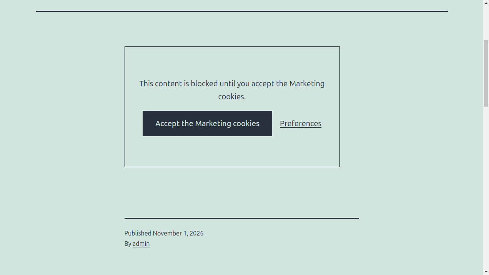

# Blocking the third parties

The scripts, the frames and the embeds of the third parties are blocked until the visitor accepts their category. A blocked script is printed with `type="text/plain"` and runs after the consent, a blocked frame keeps its address in `data-icc-src` and loads after the consent.

The plugin blocks what WordPress prints in the content, in the widgets, in the embeds and with `wp_enqueue_script()`. The pages are not buffered, so the plugin works with the cache plugins.

## Vendors

A vendor is a third party, like YouTube, with the addresses it loads from and the texts of its inline scripts. The plugin knows these vendors:

| Vendor | Category |
| --- | --- |
| Google Analytics | Statistics |
| Hotjar | Statistics |
| Google Tag Manager | Marketing |
| YouTube | Marketing |
| Vimeo | Marketing |
| Google Maps | Marketing |
| Facebook | Marketing |
| Instagram | Marketing |
| X (Twitter) | Marketing |
| LinkedIn | Marketing |
| TikTok | Marketing |
| Spotify | Marketing |
| SoundCloud | Marketing |

In **Blocking > Common vendors** you can turn off a vendor the site does not need to block.

## Custom vendors

**Add a vendor** for a third party the plugin does not know. Give it a name, a category and the texts to block: a part of the address, like `tracker.example.com/script.js`, or a text of its inline script, like `myTracker.start(`. Press Enter after each one.

## Never blocked

The addresses and the scripts the site needs, even when a vendor matches them. For example `youtube.com/embed/public-video`.

## Placeholders

A blocked frame, like a video or a map, shows a placeholder with a button that accepts its category and a link to the preferences. **Placeholder text of the blocked content** and **Placeholder button text** replace the default texts, that contain the category name.

## Block the vendors in the whole page

The scripts printed by the theme or by a plugin directly in the page, without the WordPress functions, are not blocked by default. **Block the vendors in the whole page** turns on the compatibility mode: the page is buffered and every script of a vendor is blocked. Turn it on only when it is needed, the buffer can conflict with the other plugins that use one.

## Your own scripts

To block a script of your theme, give it a category. See [Integrations](integrations.md#block-a-script).
