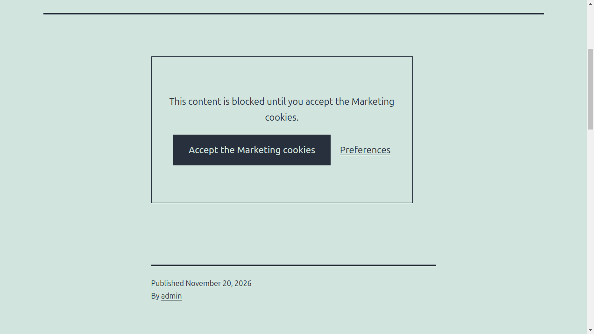

# Blocking the third parties

The scripts, the frames and the embeds of the third parties are blocked until the visitor accepts their category. A blocked script is printed with `type="text/plain"` and runs after the consent, a blocked frame keeps its address in `data-icc-src` and loads after the consent, only when it is an `http:` or `https:` address.

The plugin blocks what WordPress prints in the content, in the widgets, in the embeds and with `wp_enqueue_script()`. The pages are not buffered, so the plugin works with the cache plugins.

## Vendors

A vendor is a third party, like YouTube, with the addresses it loads from and the texts of its inline scripts. The plugin knows these vendors:

| Vendor | Category |
| --- | --- |
| Google Analytics | Statistics |
| Hotjar | Statistics |
| Microsoft Clarity | Statistics |
| Matomo Cloud | Statistics |
| Google Tag Manager | Marketing |
| Google Ads | Marketing |
| Google AdSense | Marketing |
| Microsoft Advertising | Marketing |
| YouTube | Marketing |
| Vimeo | Marketing |
| Google Maps | Marketing |
| Facebook | Marketing |
| Instagram | Marketing |
| X (Twitter) | Marketing |
| LinkedIn | Marketing |
| TikTok | Marketing |
| Pinterest | Marketing |
| Snapchat | Marketing |
| Reddit | Marketing |
| HubSpot | Marketing |
| Spotify | Marketing |
| SoundCloud | Marketing |
| Calendly | Marketing |
| Mailchimp | Marketing |
| Disqus | Marketing |
| Dailymotion | Marketing |
| Twitch | Marketing |
| Amazon Ads | Marketing |
| Google reCAPTCHA | Marketing, turned off |

In **Blocking > Common vendors** you can turn off a vendor the site does not need to block.

Google reCAPTCHA starts turned off: the forms that use it would wait for the marketing consent. Turn it on when the forms can wait. HubSpot blocks the tracking and the chat, not the forms of `js.hsforms.net`. Matomo Cloud blocks only the Matomo served by `matomo.cloud`, Matomo on your site can be set up without cookies. Mailchimp blocks the script of a connected site and the pop-up forms, not the forms that only send to Mailchimp. Calendly, Mailchimp, Disqus, Dailymotion and Twitch, added in 3.4.0, start turned off on the sites that existed before: turn them on when the site uses them.

## Consent per vendor

By default the visitors accept or refuse a category, with all its vendors. Turn on **Let the visitors choose the single vendors** in the **Blocking** tab to let them choose the vendors too: the preferences list the vendors of each category, under **Vendors**.

* Accepting a category accepts all its vendors, then the visitor can turn some of them off.
* Turning on a single vendor accepts its category, with only that vendor.
* The placeholder of a blocked video or map accepts only its vendor.
* Accept all accepts every vendor, reject all refuses them all.
* Refusing a vendor deletes the cookies it set, as the [cookie table](cookie-table.md#the-cookies-without-the-consent-are-deleted) explains.

The guidelines of the Italian Data Protection Authority ask that the visitors can choose analytically the functions, the third parties and the cookies, also grouped in categories: the choice of the vendors is the safest reading, turn it on for the sites in Italy. The list has the common vendors turned on and the custom vendors: turn off the common vendors the site does not use, **Scan the site** finds them.

## Scan the site

**Scan the site**, at the top of the **Blocking** tab, finds the vendors of your pages.

1. Choose what to scan: the home page, the post types, the categories, and single posts or pages searched by title.
2. Click **Scan the site**. The pages are read from the server in batches of ten, like a visitor that has not chosen yet, and the progress shows the pages scanned.
3. The list shows:
   * **Vendors found**: the common vendors of the pages, with the number of pages. Check **Block** to block one that is turned off.
   * **Unknown third parties**: the hosts of the scripts and frames that no vendor covers. **Add as a custom vendor** adds the host to the custom vendors, in the last category. Some hosts, like the libraries served by a CDN, set no cookies: add only the ones that do.
   * The pages that could not be read, with the reason.
4. Save the changes: the scan changes nothing by itself.

The scan reads the HTML of the pages: it finds the scripts, the frames and the tracking pixels, not the cookies that JavaScript sets in the browser, see [Cookies in the browser](#cookies-in-the-browser). The cookies of the vendors come from their presets, see the cookie table. A selection scans 500 pages at most. When the host blocks the requests of the site to itself, like the Site Health of WordPress reports, the scan shows the error of each page.

### Scheduled scan

The same pages can be scanned by themselves, with WP-Cron. In **Scheduled scan**, choose how often in **Scan the chosen pages**: never, every day, every week or every month, and click **Save the schedule**. The schedule is saved apart from the other settings, it is not in the exported file.

* The first scan runs one hour after the save, each run reads ten pages and plans the next ten, until the selection is done.
* The scan reports what needs an action: the vendors found and not blocked, and the unknown third parties. Only what the scan before did not report is new.
* The new findings show a notice to the administrators: **Check them** opens the Blocking tab, **Ignore** hides the notice until the next findings. Check **Email the new findings** to receive them at the admin email of the site too.
* The tab shows the date and the findings of the last scheduled scan.

WP-Cron runs when the site gets visits: on a site with few visits, or with `DISABLE_WP_CRON`, use a real cron job of the server.

### Cookies in the browser

**Scan the cookies in the browser**, below the results of the scan, finds the cookies your pages set while they load, with their duration: the first-party cookies of the scripts and the plugins, like the cart of the shop or the language, that the vendor presets do not cover.

1. Choose the pages, like for **Scan the site**, and click **Scan the cookies in the browser**.
2. Each page is loaded in a hidden frame, one at a time, with every category accepted in memory: the scripts that wait for the consent run, no consent cookie is saved, no consent is logged and the banner stays closed. The page gets a few seconds after the load for the scripts that start later.
3. The list shows each cookie with its duration, the number of pages and who sets it: a vendor, a site cookie, or **Unknown**. **Add as a site cookie** adds an unknown cookie to the site cookies, with its duration filled in: choose its category, write its purpose and save.

The page opens with a one-time address that is valid for five minutes, and it is never cached. The scan reads the cookies of the scripts, with their duration, and the cookies the server sends, HttpOnly included.

* In Chrome and Edge the frame loads the pages as an anonymous visitor, with cookies of its own: the scan changes neither your cookies nor your login. Firefox and Safari load them as the logged-in administrator, and some plugins do not track the administrators: the panel shows a warning.
* The cookies set by the frames of other sites, like a YouTube video, and by a click, a scroll or a cart action are not found: the vendor cookies come from their presets.
* A page that refuses to open in a frame, like with the `X-Frame-Options` header of a security plugin, is reported with the reason. A page cache that serves the address with `icc_scan` is reported too: exclude that parameter from the cache.

### Scan assistant

From WordPress 7.0, with an AI provider for text set in **Settings > Connectors**, the scans can suggest what they found. Without a provider, or on an older WordPress, the assistant is hidden.

* **Suggest with AI**, below the unknown third parties of **Scan the site**, suggests the name of each one, the category of its scripts and their purpose. **Add as a custom vendor** then uses the suggested name and category.
* **Suggest with AI**, below the cookies of **Scan the cookies in the browser**, suggests who sets each unknown cookie, its category and its purpose. **Add as a site cookie** then uses the suggested category and purpose.
* **Discard the suggestion** drops it, the add button goes back to the defaults.

The assistant runs only when you click, and nothing is saved before you add a suggestion and save the settings. It sends to the AI provider of the site only the names of the hosts and of the cookies, the categories and the common vendors: never the data of the visitors or the consent log. The suggestions can be wrong, check each one. After the first use, the suggested text of the privacy policy, in **Settings > Privacy**, says that the site owner used an AI service in this way.

## Google tag gateway

With the Google tag gateway the Google tags load from a path of your site, like `/metrics`, instead of `googletagmanager.com`. The plugin blocks them by the id in their address: `G-` and `GT-` wait for the statistics consent like Google Analytics, `AW-` and `DC-` wait for the marketing consent like Google Ads, `GTM-` waits for the marketing consent like Google Tag Manager. The inline loader of Google Tag Manager is blocked on any host too.

When the address of a tag has no id, write the path in **Integrations > Google tag gateway path**, like `/metrics`: every script and frame under it waits for the marketing consent.

## Custom vendors

**Add a vendor** for a third party the plugin does not know. Give it a name, a category and the texts to block: a part of the address, like `tracker.example.com/script.js`, or a text of its inline script, like `myTracker.start(`. Press Enter after each one.

## Never blocked

The addresses and the scripts the site needs, even when a vendor matches them. For example `youtube.com/embed/public-video`.

## Placeholders



A blocked frame, like a video or a map, shows a placeholder with a button that accepts its category and a link to the preferences. **Placeholder text of the blocked content** and **Placeholder button text** replace the default texts, that contain the category name.

To hide the placeholders, add this rule to the **Custom CSS**:

```css
.icc-placeholder {
	display: none !important;
}
```

The blocked frame stays hidden until the consent, the visitors accept its category from the banner or the preferences.

## Block the vendors in the whole page

The scripts printed by the theme or by a plugin directly in the page, without the WordPress functions, are not blocked by default. **Block the vendors in the whole page** turns on the compatibility mode: the page is buffered and every script of a vendor is blocked. Turn it on only when it is needed, the buffer can conflict with the other plugins that use one.

## Your own scripts

To block a script of your theme, give it a category. See [Integrations](integrations.md#block-a-script).
