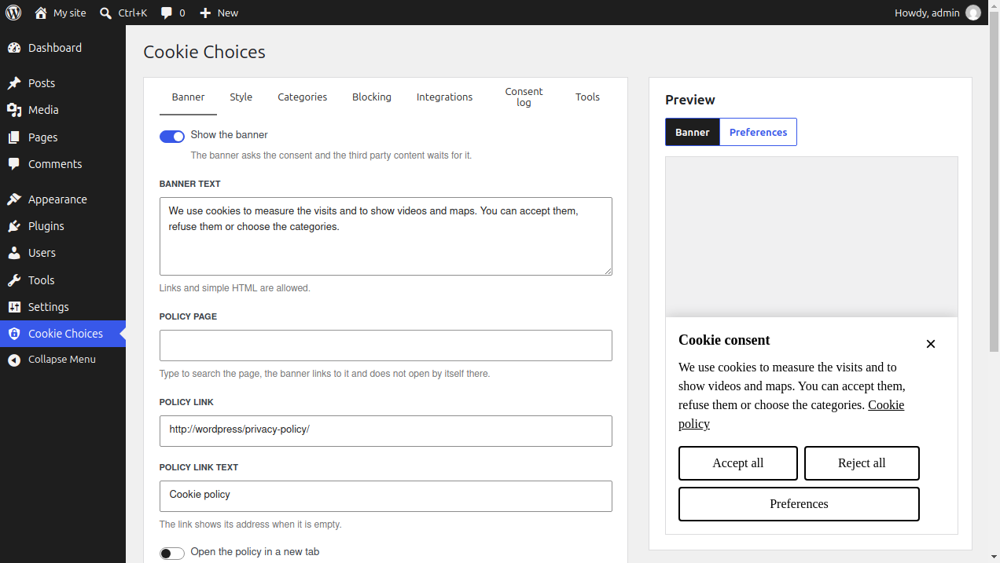
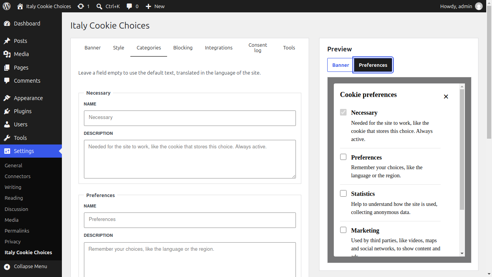
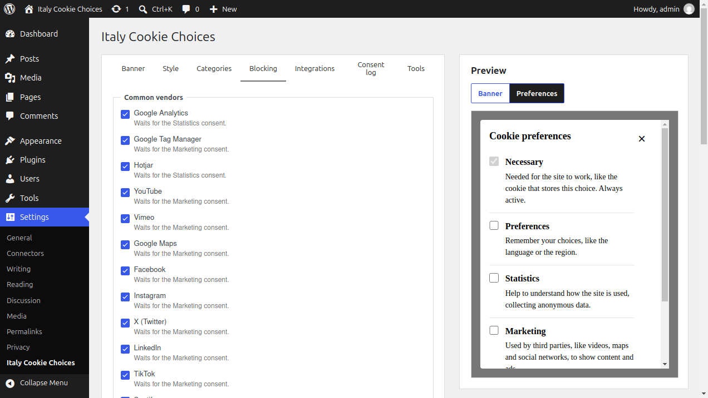
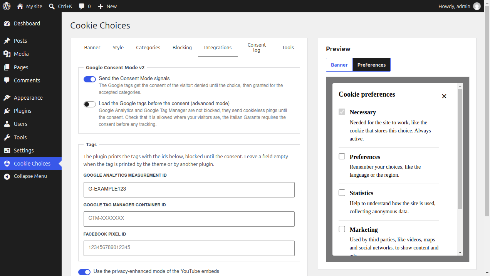
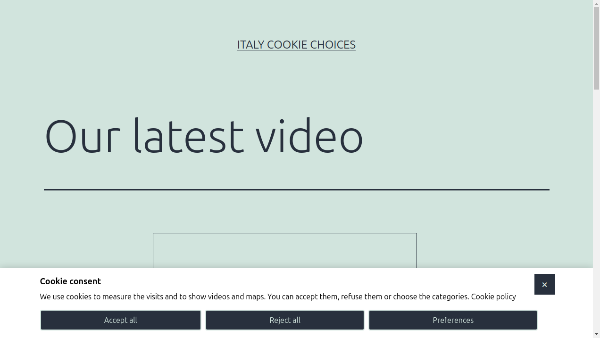
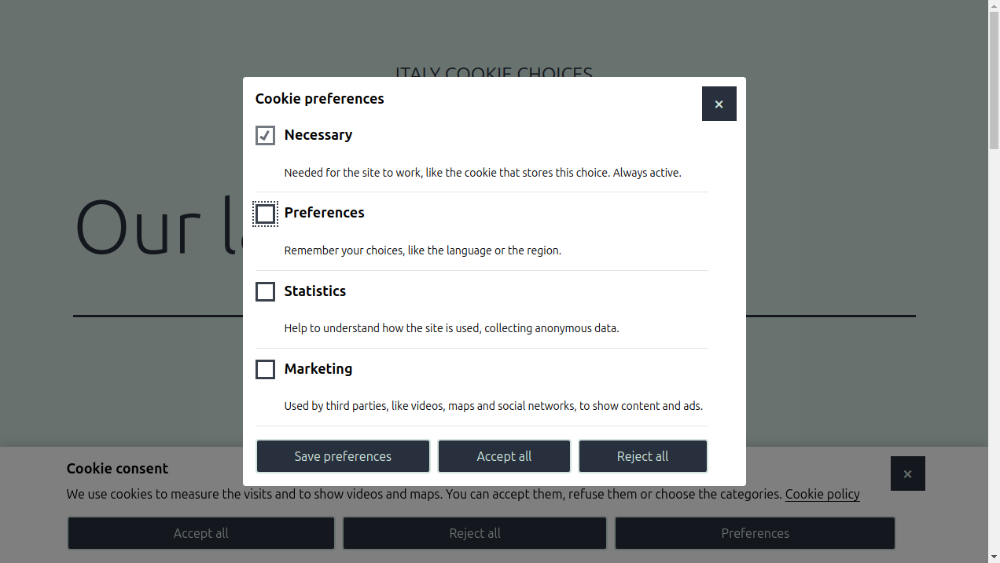

# Getting started

Install and activate the plugin, then open **Settings > Italy Cookie Choices**.

The settings are grouped in tabs. The preview on the right shows the banner, or the preferences dialog, with the changes not saved yet. **Save changes** saves every tab at once.

## Banner

* **Show the banner**: turns the plugin on. Without it nothing is printed and nothing is blocked.
* **Banner text**: the message, links and simple HTML are allowed.
* **Policy page**: type to search the page of your cookie policy. The banner links to it, and on that page the banner does not open by itself, so the visitor can read the policy.
* **Policy link** and **Policy link text**: the address and the text of the link, filled by the policy page or written by hand.
* **Open the policy in a new tab** and **Add rel="nofollow"**: the attributes of the link.
* **Accept button text**: the text of the button that accepts every category.
* **Pages where the banner does not open by itself**: page IDs or slugs, separated by commas.
* **Reload the page after the choice**: for the themes that need a reload to show the content accepted.

The banner always has three buttons with the same importance: accept all, reject all and preferences. Closing it with the X keeps only the necessary cookies.

## Style

* **Position**: a bar at the top, a bar at the bottom or a modal window.
* **Template**: default, big buttons, small buttons, or custom. The custom template prints no style, only your custom CSS.
* **Background color** and **Text color**.
* **Custom CSS**: added after the styles of the plugin.
* **CSS classes**: extra classes for the banner and its parts, for example the button classes of your theme.

The banner uses the `icc-banner` classes and the `--icc-background`, `--icc-color`, `--icc-button-padding` and `--icc-button-font-size` custom properties.

## Categories

The cookies are grouped in four categories: **Necessary**, always active, **Preferences**, **Statistics** and **Marketing**. Here you change their names and descriptions in the preferences dialog. Leave a field empty to use the default text, translated in the language of the site.

## Blocking

The common vendors, like Google Analytics, YouTube, Google Maps and Facebook, are blocked until the consent to their category. You can turn a vendor off, add your own vendors and list the addresses that are never blocked. See [Blocking the third parties](blocking.md).

## Integrations

* **Send the Consent Mode signals**: Google Consent Mode v2, on by default.
* **Load the Google tags before the consent (advanced mode)**: see [Integrations](integrations.md#basic-and-advanced-mode) before you turn it on.
* **Google Analytics measurement ID**, **Google Tag Manager container ID** and **Facebook pixel ID**: the plugin prints these tags, blocked until the consent. Leave them empty when the tags are printed by your theme or by another plugin.
* **Use the privacy-enhanced mode of the YouTube embeds**: the videos load from youtube-nocookie.com.

## Consent log

The log demonstrates the consents, see [Consent log](consent-log.md).

## Tools

* **Cookie of the 2.x versions**: the name and the value of the cookie the 2.x versions wrote on accept. The plugin still writes it while every category is accepted, for the code that reads it.
* **Export the settings**: downloads the saved settings as a JSON file.
* **Import**: replaces the saved settings with the ones of an exported file, also of the 2.x versions.

## What the visitors see

The choice lasts six months. The visitor can change it, or withdraw the consent, from the preferences: add a button that opens them to the footer or to the cookie policy page.

* The **Cookie preferences button** block, in the block editor.
* The `[cookie_preferences text="Change your cookie choices"]` shortcode. The `[delete_cookie]` shortcode of the 2.x versions prints the same button.
* A link to `#icc-preferences`, like `<a href="#icc-preferences">Cookie preferences</a>`, for example in a menu.

The `[accept_button text="I agree"]` shortcode prints a button that accepts every category.
