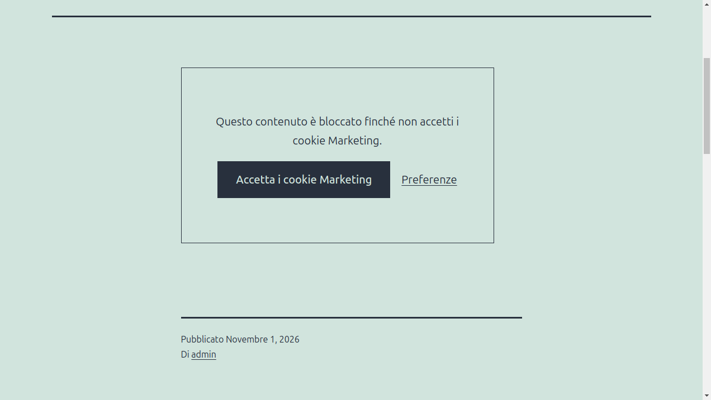

# Blocco delle terze parti

Gli script, i frame e gli embed delle terze parti sono bloccati finché il visitatore non accetta la loro categoria. Uno script bloccato viene stampato con `type="text/plain"` ed eseguito dopo il consenso, un frame bloccato tiene il suo indirizzo in `data-icc-src` e viene caricato dopo il consenso.

Il plugin blocca quello che WordPress stampa nel contenuto, nei widget, negli embed e con `wp_enqueue_script()`. Le pagine non vengono messe in un buffer, quindi il plugin funziona con i plugin di cache.

## Fornitori

Un fornitore è una terza parte, come YouTube, con gli indirizzi da cui carica i suoi file e i testi dei suoi script inline. Il plugin conosce questi fornitori:

| Fornitore | Categoria |
| --- | --- |
| Google Analytics | Statistiche |
| Hotjar | Statistiche |
| Google Tag Manager | Marketing |
| YouTube | Marketing |
| Vimeo | Marketing |
| Google Maps | Marketing |
| Facebook | Marketing |
| Instagram | Marketing |
| X (Twitter) | Marketing |
| LinkedIn | Marketing |
| TikTok | Marketing |
| Spotify | Marketing |
| SoundCloud | Marketing |

In **Blocco > Fornitori comuni** puoi disattivare un fornitore che il sito non ha bisogno di bloccare.

## Fornitori personalizzati

**Aggiungi un fornitore** per una terza parte che il plugin non conosce. Dagli un nome, una categoria e i testi da bloccare: una parte dell'indirizzo, come `tracker.example.com/script.js`, o un testo del suo script inline, come `myTracker.start(`. Premi Invio dopo ognuno.

## Mai bloccati

Gli indirizzi e gli script che servono al sito, anche quando corrispondono a un fornitore. Per esempio `youtube.com/embed/video-pubblico`.

## Segnaposto

Un frame bloccato, come un video o una mappa, mostra un segnaposto con un pulsante che accetta la sua categoria e un link alle preferenze. **Testo segnaposto dei contenuti bloccati** e **Testo del pulsante del segnaposto** sostituiscono i testi predefiniti, che contengono il nome della categoria.

## Blocca i fornitori in tutta la pagina

Gli script stampati dal tema o da un plugin direttamente nella pagina, senza le funzioni di WordPress, non vengono bloccati per impostazione predefinita. **Blocca i fornitori in tutta la pagina** attiva la modalità di compatibilità: la pagina viene messa in un buffer e ogni script di un fornitore viene bloccato. Attivala solo quando serve, il buffer può entrare in conflitto con gli altri plugin che ne usano uno.

## I tuoi script

Per bloccare uno script del tuo tema, assegnagli una categoria. Vedi [Integrazioni](integrazioni.md#bloccare-uno-script).
