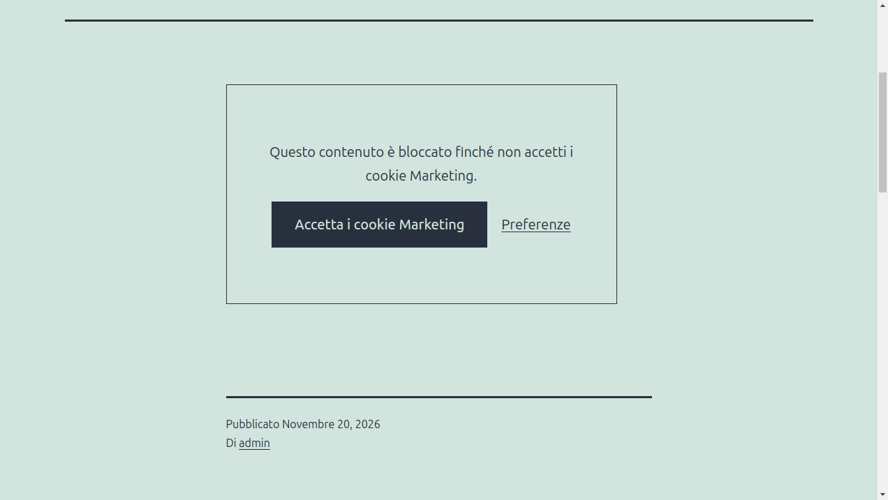

# Blocco delle terze parti

Gli script, i frame e gli embed delle terze parti sono bloccati finché il visitatore non accetta la loro categoria. Uno script bloccato viene stampato con `type="text/plain"` ed eseguito dopo il consenso, un frame bloccato tiene il suo indirizzo in `data-icc-src` e viene caricato dopo il consenso, solo se è un indirizzo `http:` o `https:`.

Il plugin blocca quello che WordPress stampa nel contenuto, nei widget, negli embed e con `wp_enqueue_script()`. Le pagine non vengono messe in un buffer, quindi il plugin funziona con i plugin di cache.

## Fornitori

Un fornitore è una terza parte, come YouTube, con gli indirizzi da cui carica i suoi file e i testi dei suoi script inline. Il plugin conosce questi fornitori:

| Fornitore | Categoria |
| --- | --- |
| Google Analytics | Statistiche |
| Hotjar | Statistiche |
| Microsoft Clarity | Statistiche |
| Matomo Cloud | Statistiche |
| Google Tag Manager | Marketing |
| Google Ads | Marketing |
| Google AdSense | Marketing |
| Microsoft Advertising | Marketing |
| YouTube | Marketing |
| Vimeo | Marketing |
| Google Maps | Marketing |
| Facebook | Marketing |
| Instagram | Marketing |
| X (Twitter) | Marketing |
| LinkedIn | Marketing |
| TikTok | Marketing |
| Pinterest | Marketing |
| Snapchat | Marketing |
| Reddit | Marketing |
| HubSpot | Marketing |
| Spotify | Marketing |
| SoundCloud | Marketing |
| Google reCAPTCHA | Marketing, disattivato |

In **Blocco > Fornitori comuni** puoi disattivare un fornitore che il sito non ha bisogno di bloccare.

Google reCAPTCHA parte disattivato: i moduli che lo usano aspetterebbero il consenso al marketing. Attivalo quando i moduli possono aspettare. HubSpot blocca il tracciamento e la chat, non i moduli di `js.hsforms.net`. Matomo Cloud blocca solo il Matomo servito da `matomo.cloud`, Matomo sul tuo sito può essere configurato senza cookie.

## Consenso per fornitore

Di default i visitatori accettano o rifiutano una categoria, con tutti i suoi fornitori. Attiva **Fai scegliere ai visitatori i singoli fornitori** nella scheda **Blocco** per far scegliere anche i fornitori: le preferenze elencano i fornitori di ogni categoria, sotto **Fornitori**.

* Accettare una categoria accetta tutti i suoi fornitori, poi il visitatore può disattivarne alcuni.
* Attivare un singolo fornitore accetta la sua categoria, con solo quel fornitore.
* Il segnaposto di un video o di una mappa bloccati accetta solo il suo fornitore.
* Accetta tutto accetta tutti i fornitori, rifiuta tutto li rifiuta tutti.

Le linee guida del Garante per la protezione dei dati personali chiedono che i visitatori possano scegliere in modo analitico le funzionalità, le terze parti e i cookie, anche raggruppati in categorie: la scelta dei fornitori è la lettura più sicura, attivala per i siti in Italia. L'elenco ha i fornitori comuni attivi e i fornitori personalizzati: disattiva i fornitori comuni che il sito non usa, **Scansiona il sito** li trova.

## Scansiona il sito

**Scansiona il sito**, in cima alla scheda **Blocco**, trova i fornitori delle tue pagine.

1. Scegli cosa scansionare: la home page, i tipi di contenuto, le categorie, e singoli articoli o pagine cercati per titolo.
2. Fai clic su **Scansiona il sito**. Le pagine vengono lette dal server a gruppi di dieci, come un visitatore che non ha ancora scelto, e l'avanzamento mostra le pagine scansionate.
3. L'elenco mostra:
   * **Fornitori trovati**: i fornitori comuni delle pagine, con il numero di pagine. Spunta **Blocca** per bloccarne uno disattivato.
   * **Terze parti sconosciute**: gli host degli script e dei frame che nessun fornitore copre. **Aggiungi come fornitore personalizzato** aggiunge l'host ai fornitori personalizzati, nell'ultima categoria. Alcuni host, come le librerie servite da una CDN, non impostano cookie: aggiungi solo quelli che lo fanno.
   * Le pagine che non è stato possibile leggere, con il motivo.
4. Salva le modifiche: la scansione non cambia nulla da sola.

La scansione legge l'HTML delle pagine: trova gli script, i frame e i pixel di tracciamento, non i cookie che JavaScript imposta nel browser. I cookie dei fornitori arrivano dai loro preset, vedi la tabella dei cookie. Una selezione scansiona al massimo 500 pagine. Quando l'hosting blocca le richieste del sito a sé stesso, come segnala Salute del sito di WordPress, la scansione mostra l'errore di ogni pagina.

### Scansione programmata

Le stesse pagine possono essere scansionate da sole, con WP-Cron. In **Scansione programmata**, scegli ogni quanto in **Scansiona le pagine scelte**: mai, ogni giorno, ogni settimana o ogni mese, e fai clic su **Salva la programmazione**. La programmazione viene salvata a parte dalle altre impostazioni, non è nel file esportato.

* La prima scansione parte un'ora dopo il salvataggio, ogni esecuzione legge dieci pagine e programma le dieci successive, fino alla fine della selezione.
* La scansione segnala cosa richiede un'azione: i fornitori trovati e non bloccati, e le terze parti sconosciute. È nuovo solo quello che la scansione precedente non aveva segnalato.
* I nuovi risultati mostrano un avviso agli amministratori: **Controllali** apre la scheda Blocco, **Ignora** nasconde l'avviso fino ai prossimi risultati. Spunta **Invia i nuovi risultati via email** per riceverli anche all'email dell'amministratore del sito.
* La scheda mostra la data e i risultati dell'ultima scansione programmata.

WP-Cron parte quando il sito riceve visite: su un sito con poche visite, o con `DISABLE_WP_CRON`, usa un vero cron job del server.

## Google tag gateway

Con il Google tag gateway i tag di Google vengono caricati da un percorso del tuo sito, come `/metrics`, invece che da `googletagmanager.com`. Il plugin li blocca dall'id nel loro indirizzo: `G-` e `GT-` aspettano il consenso alle statistiche come Google Analytics, `AW-` e `DC-` aspettano il consenso al marketing come Google Ads, `GTM-` aspetta il consenso al marketing come Google Tag Manager. Anche lo script inline che carica Google Tag Manager viene bloccato su qualsiasi dominio.

Quando l'indirizzo di un tag non ha l'id, scrivi il percorso in **Integrazioni > Percorso del Google tag gateway**, come `/metrics`: ogni script e frame sotto quel percorso aspetta il consenso al marketing.

## Fornitori personalizzati

**Aggiungi un fornitore** per una terza parte che il plugin non conosce. Dagli un nome, una categoria e i testi da bloccare: una parte dell'indirizzo, come `tracker.example.com/script.js`, o un testo del suo script inline, come `myTracker.start(`. Premi Invio dopo ognuno.

## Mai bloccati

Gli indirizzi e gli script che servono al sito, anche quando corrispondono a un fornitore. Per esempio `youtube.com/embed/video-pubblico`.

## Segnaposto



Un frame bloccato, come un video o una mappa, mostra un segnaposto con un pulsante che accetta la sua categoria e un link alle preferenze. **Testo segnaposto dei contenuti bloccati** e **Testo del pulsante del segnaposto** sostituiscono i testi predefiniti, che contengono il nome della categoria.

Per nascondere i segnaposto, aggiungi questa regola al **CSS personalizzato**:

```css
.icc-placeholder {
	display: none !important;
}
```

Il frame bloccato resta nascosto fino al consenso, i visitatori accettano la sua categoria dal banner o dalle preferenze.

## Blocca i fornitori in tutta la pagina

Gli script stampati dal tema o da un plugin direttamente nella pagina, senza le funzioni di WordPress, non vengono bloccati per impostazione predefinita. **Blocca i fornitori in tutta la pagina** attiva la modalità di compatibilità: la pagina viene messa in un buffer e ogni script di un fornitore viene bloccato. Attivala solo quando serve, il buffer può entrare in conflitto con gli altri plugin che ne usano uno.

## I tuoi script

Per bloccare uno script del tuo tema, assegnagli una categoria. Vedi [Integrazioni](integrazioni.md#bloccare-uno-script).
