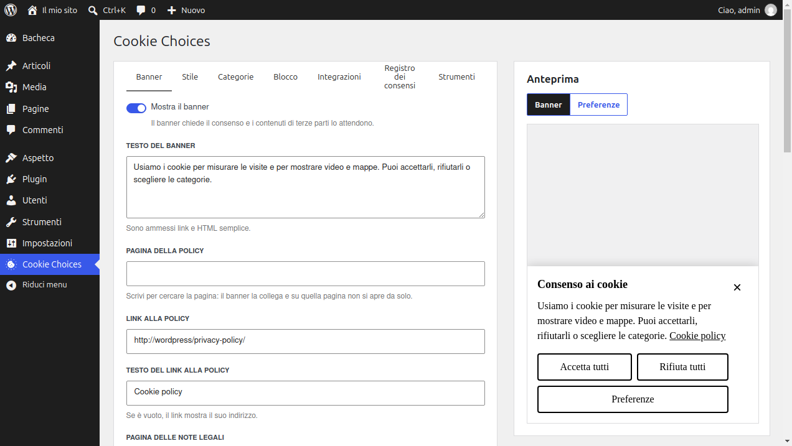
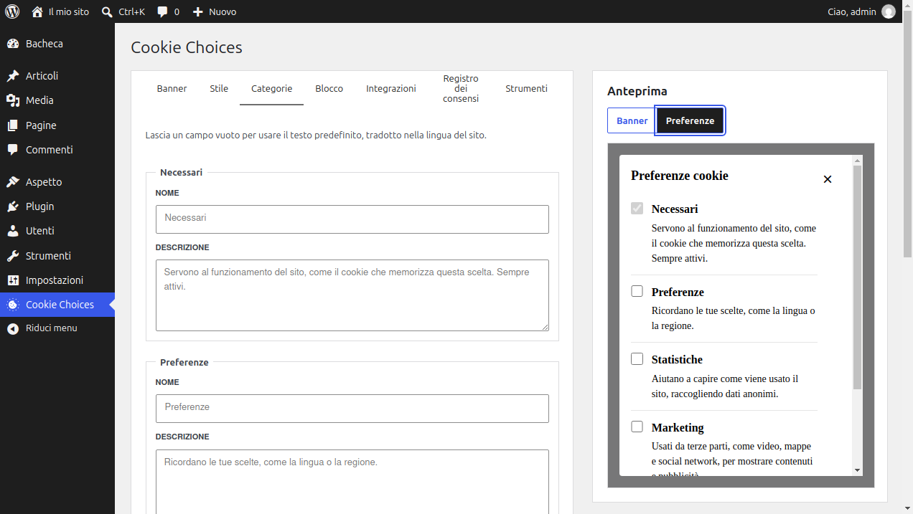
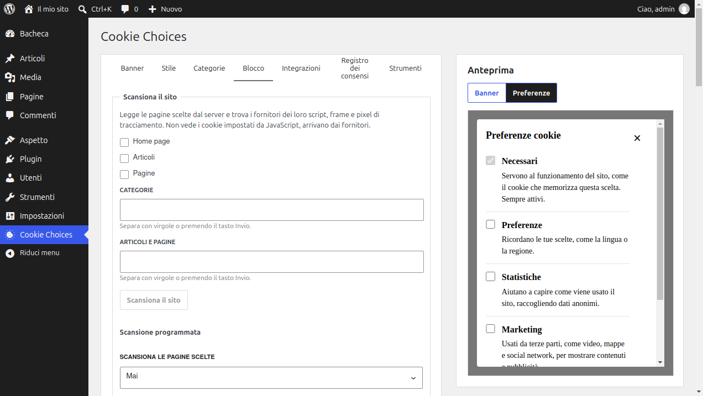
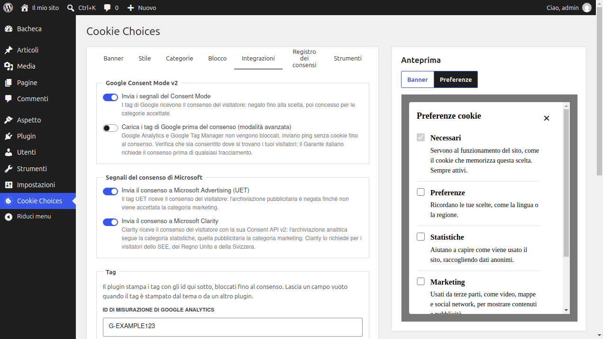
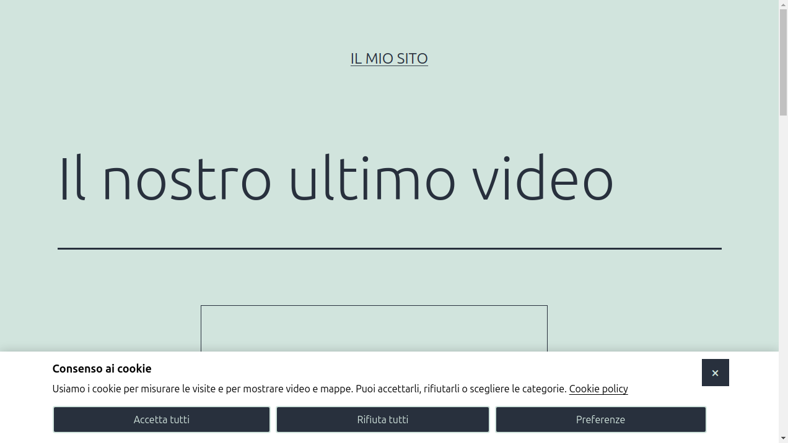
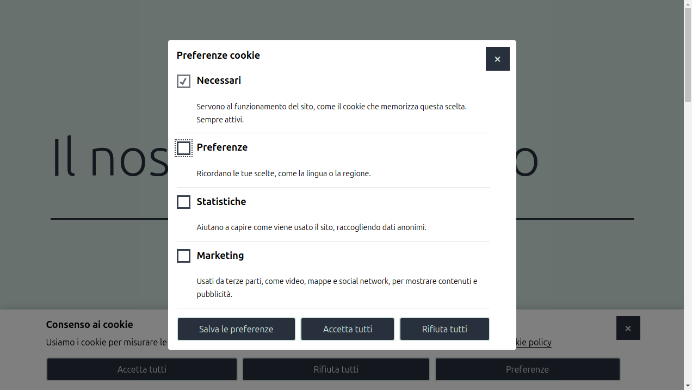

# Guida introduttiva

Installa e attiva il plugin, poi apri **Cookie Choices** nel menu di amministrazione.

Le impostazioni sono divise in schede. L'anteprima a destra mostra il banner, o la finestra delle preferenze, con le modifiche non ancora salvate. **Salva le modifiche** salva tutte le schede insieme.

## Banner

* **Mostra il banner**: attiva il plugin. Senza questa opzione non viene stampato né bloccato niente.
* **Testo del banner**: il messaggio, sono ammessi link e HTML semplice.
* **Pagina della policy**: scrivi per cercare la pagina della tua cookie policy. Il banner la collega e su quella pagina non si apre da solo, così il visitatore può leggerla.
* **Link alla policy** e **Testo del link alla policy**: l'indirizzo e il testo del link, compilati dalla pagina della policy o scritti a mano.
* **Pagina delle note legali**, **Link alle note legali** e **Testo del link alle note legali**: le note legali (Impressum) che mostrano i siti di Germania e Austria, collegate accanto alla policy. Come sulla pagina della policy, lì il banner non si apre da solo. Lascia il link vuoto quando il sito non ha note legali.
* **Apri i link in una nuova scheda** e **Aggiungi rel="nofollow" ai link**: gli attributi dei link alla policy e alle note legali.
* **Testo del pulsante di accettazione**, **Testo del pulsante di rifiuto** e **Testo del pulsante delle preferenze**: i testi dei tre pulsanti del banner, **Testo del pulsante di salvataggio** il testo del pulsante delle preferenze che salva la scelta. Lascia un campo vuoto per il testo predefinito, tradotto nella lingua del sito.
* **Pagine dove il banner non si apre da solo**: ID o slug delle pagine, separati da virgole.
* **Chiedi di nuovo il consenso dopo**: 1, 3, 6 o 12 mesi, 6 di default, come raccomanda il Garante per la protezione dei dati personali. Passato questo tempo il banner chiede di nuovo il consenso al visitatore. La modifica vale anche per i consensi già dati, dalla loro data.
* **Dominio dei cookie**: vuoto di default, il consenso viene salvato solo per il dominio del sito. Scrivi il dominio principale, come `example.com`, per condividere il consenso con i suoi sottodomini: un visitatore che sceglie su `www.example.com` non vede di nuovo il banner su `shop.example.com`. Ogni sottodominio ha bisogno del plugin con le stesse impostazioni. Un dominio di cui il sito non fa parte, come `example.org` per `www.example.com`, non viene salvato, i browser lo rifiuterebbero.
* **Ricarica la pagina dopo la scelta**: per i temi che hanno bisogno di ricaricare la pagina per mostrare i contenuti accettati.
* **Rispetta il Global Privacy Control del browser**: attivo di default. Alcuni browser, come Brave e DuckDuckGo, o Firefox con un'opzione, inviano il segnale [Global Privacy Control](https://globalprivacycontrol.org/) per chiedere ai siti di non condividere i dati del visitatore. Con il segnale, accetta tutti esclude i cookie di marketing e il banner spiega il perché; il visitatore può comunque sceglierli nelle preferenze. Il banner chiede comunque il consenso.
* **Mostra un pulsante fluttuante per cambiare il consenso**: dopo la scelta, un piccolo pulsante rotondo nell'angolo in basso a sinistra o a destra apre le preferenze, così i visitatori possono cambiare o revocare il consenso senza il blocco o il link. La sua etichetta viene letta dagli screen reader, *Preferenze cookie* quando è vuota.

Il banner ha sempre tre pulsanti con la stessa importanza: accetta tutti, rifiuta tutti e preferenze. Chiuderlo con la X mantiene solo i cookie necessari.

## Stile

* **Posizione**: una barra in alto, una barra in basso, una finestra modale, o un riquadro nell'angolo in basso a sinistra o a destra. Nel riquadro i tre pulsanti sono uno sopra l'altro, con la stessa larghezza.
* **Logo**: un'immagine della libreria media, mostrata sopra il titolo del banner. Il suo testo alternativo viene dalla libreria media.
* **Modello**: predefinito, pulsanti grandi, pulsanti piccoli o personalizzato. Il modello personalizzato non stampa stili, solo il tuo CSS personalizzato.
* **Colore di sfondo** e **Colore del testo**.
* **CSS personalizzato**: aggiunto dopo gli stili del plugin.
* **Classi CSS**: classi aggiuntive per il banner e le sue parti, per esempio le classi dei pulsanti del tuo tema.

Il banner usa le classi `icc-banner` e le proprietà personalizzate `--icc-background`, `--icc-color`, `--icc-button-padding` e `--icc-button-font-size`.

## Categorie

I cookie sono raggruppati in quattro categorie: **Necessari**, sempre attivi, **Preferenze**, **Statistiche** e **Marketing**. Qui puoi cambiarne i nomi e le descrizioni nella finestra delle preferenze. Lascia un campo vuoto per usare il testo predefinito, tradotto nella lingua del sito.

## Blocco

I fornitori comuni, come Google Analytics, YouTube, Google Maps e Facebook, sono bloccati finché non viene accettata la loro categoria. Puoi disattivare un fornitore, aggiungerne di tuoi e indicare gli indirizzi che non vengono mai bloccati. **Scansiona il sito** trova i fornitori delle tue pagine. Vedi [Blocco delle terze parti](blocco.md).

## Integrazioni

* **Invia i segnali del Consent Mode**: Google Consent Mode v2, attivo per impostazione predefinita.
* **Carica i tag di Google prima del consenso (modalità avanzata)**: leggi [Integrazioni](integrazioni.md#modalità-base-e-avanzata) prima di attivarla.
* **ID di misurazione di Google Analytics**, **ID del contenitore di Google Tag Manager** e **ID del pixel di Facebook**: il plugin stampa questi tag, bloccati fino al consenso. Lasciali vuoti quando i tag sono stampati dal tema o da un altro plugin.
* **Script dopo il consenso**: codice che il plugin aggiunge alle pagine dopo il consenso alla sua categoria, vedi [Integrazioni](integrazioni.md#script-dopo-il-consenso).
* **Usa la modalità privacy avanzata per i video di YouTube**: i video vengono caricati da youtube-nocookie.com.

## Registro dei consensi

Il registro dimostra i consensi, vedi [Registro dei consensi](registro-consensi.md).

## Strumenti

* **Importa da un altro plugin**: le impostazioni di un altro plugin per il consenso trovate nel database, vedi [Importare da un altro plugin](migrazione.md).
* **Cookie delle versioni 2.x**: il nome e il valore del cookie che le versioni 2.x scrivevano all'accettazione. Il plugin lo scrive ancora quando tutte le categorie sono accettate, per il codice che lo legge.
* **Esporta le impostazioni**: scarica le impostazioni salvate in un file JSON.
* **Importa**: sostituisce le impostazioni salvate con quelle di un file esportato, anche dalle versioni 2.x.

## Widget della bacheca

Il widget **Cookie Choices** della bacheca mostra, agli utenti che possono gestire le impostazioni, cosa rende valido il consenso. Ogni riga apre la sua scheda:

* Il banner, il link alla policy e il numero di fornitori bloccati.
* Google Consent Mode, quando è impostato un tag di Google, e il Global Privacy Control.
* Il registro dei consensi e l'ultima scansione, con i fornitori non bloccati e le terze parti sconosciute che ha trovato.

Un'icona verde va bene, una gialla va controllata. Con il registro dei consensi attivo, il widget conta anche le scelte di questo mese: accettate, rifiutate e parziali, gli stessi numeri della scheda **Registro dei consensi**. Tutto viene calcolato sul sito.

## Cosa vedono i visitatori

La scelta dura sei mesi, anche in Safari: Safari conserva i cookie scritti da JavaScript per 7 giorni al massimo, quindi dopo ogni scelta il browser chiede al sito, su `/wp-json/italy-cookie-choices/v1/consent-cookie`, di impostare di nuovo lo stesso cookie del consenso dal server. Il visitatore può modificarla, o revocare il consenso, dalle preferenze: aggiungi un pulsante che le apre nel footer o nella pagina della cookie policy.

* Il blocco **Pulsante delle preferenze cookie**, nell'editor a blocchi.
* Lo shortcode `[cookie_preferences text="Modifica le tue scelte sui cookie"]`. Lo shortcode `[delete_cookie]` delle versioni 2.x stampa lo stesso pulsante.
* Un link a `#icc-preferences`, come `<a href="#icc-preferences">Preferenze cookie</a>`, per esempio in un menu.

Lo shortcode `[accept_button text="Accetto"]` stampa un pulsante che accetta tutte le categorie.
