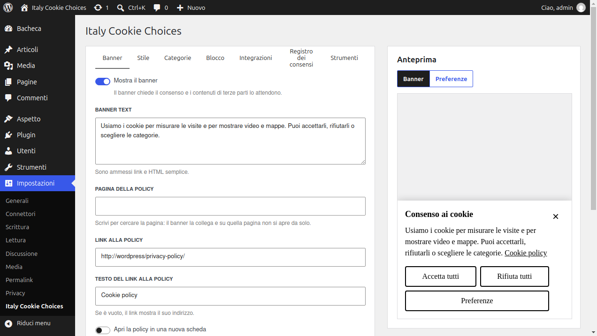
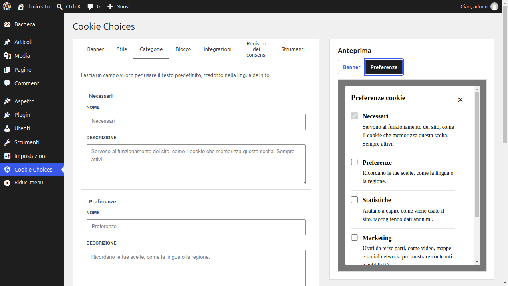
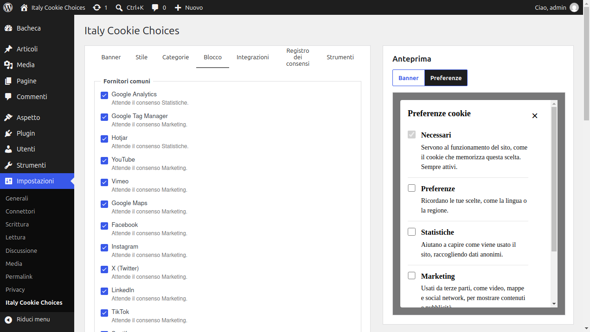
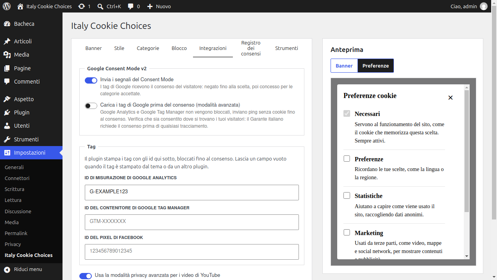
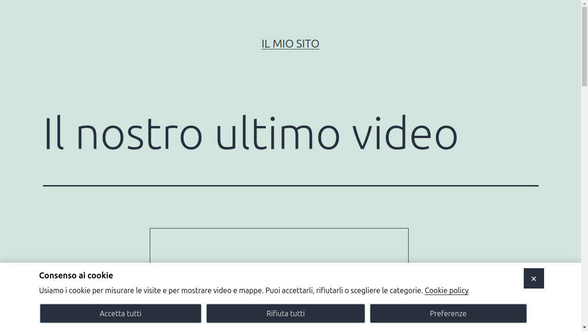
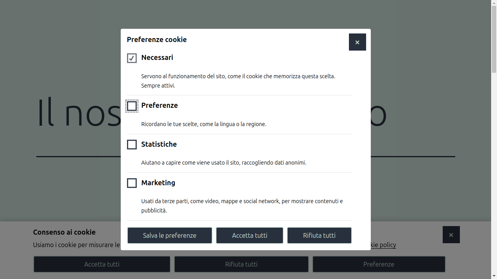

# Guida introduttiva

Installa e attiva il plugin, poi apri **Impostazioni > Italy Cookie Choices**.

Le impostazioni sono divise in schede. L'anteprima a destra mostra il banner, o la finestra delle preferenze, con le modifiche non ancora salvate. **Salva le modifiche** salva tutte le schede insieme.

## Banner

- **Mostra il banner**: attiva il plugin. Senza questa opzione non viene stampato né bloccato niente.
- **Testo del banner**: il messaggio, sono ammessi link e HTML semplice.
- **Pagina della policy**: scrivi per cercare la pagina della tua cookie policy. Il banner la collega e su quella pagina non si apre da solo, così il visitatore può leggerla.
- **Link alla policy** e **Testo del link alla policy**: l'indirizzo e il testo del link, compilati dalla pagina della policy o scritti a mano.
- **Apri la policy in una nuova scheda** e **Aggiungi rel="nofollow"**: gli attributi del link.
- **Testo del pulsante di accettazione**: il testo del pulsante che accetta tutte le categorie.
- **Pagine dove il banner non si apre da solo**: ID o slug delle pagine, separati da virgole.
- **Ricarica la pagina dopo la scelta**: per i temi che hanno bisogno di ricaricare la pagina per mostrare i contenuti accettati.

Il banner ha sempre tre pulsanti con la stessa importanza: accetta tutti, rifiuta tutti e preferenze. Chiuderlo con la X mantiene solo i cookie necessari.

## Stile

- **Posizione**: una barra in alto, una barra in basso o una finestra modale.
- **Modello**: predefinito, pulsanti grandi, pulsanti piccoli o personalizzato. Il modello personalizzato non stampa stili, solo il tuo CSS personalizzato.
- **Colore di sfondo** e **Colore del testo**.
- **CSS personalizzato**: aggiunto dopo gli stili del plugin.
- **Classi CSS**: classi aggiuntive per il banner e le sue parti, per esempio le classi dei pulsanti del tuo tema.

Il banner usa le classi `icc-banner` e le proprietà personalizzate `--icc-background`, `--icc-color`, `--icc-button-padding` e `--icc-button-font-size`.

## Categorie

I cookie sono raggruppati in quattro categorie: **Necessari**, sempre attivi, **Preferenze**, **Statistiche** e **Marketing**. Qui puoi cambiarne i nomi e le descrizioni nella finestra delle preferenze. Lascia un campo vuoto per usare il testo predefinito, tradotto nella lingua del sito.

## Blocco

I fornitori comuni, come Google Analytics, YouTube, Google Maps e Facebook, sono bloccati finché non viene accettata la loro categoria. Puoi disattivare un fornitore, aggiungerne di tuoi e indicare gli indirizzi che non vengono mai bloccati. Vedi [Blocco delle terze parti](blocco.md).

## Integrazioni

- **Invia i segnali del Consent Mode**: Google Consent Mode v2, attivo per impostazione predefinita.
- **Carica i tag di Google prima del consenso (modalità avanzata)**: leggi [Integrazioni](integrazioni.md#modalità-base-e-avanzata) prima di attivarla.
- **ID di misurazione di Google Analytics**, **ID del contenitore di Google Tag Manager** e **ID del pixel di Facebook**: il plugin stampa questi tag, bloccati fino al consenso. Lasciali vuoti quando i tag sono stampati dal tema o da un altro plugin.
- **Usa la modalità privacy avanzata per i video di YouTube**: i video vengono caricati da youtube-nocookie.com.

## Registro dei consensi

Il registro dimostra i consensi, vedi [Registro dei consensi](registro-consensi.md).

## Strumenti

- **Cookie delle versioni 2.x**: il nome e il valore del cookie che le versioni 2.x scrivevano all'accettazione. Il plugin lo scrive ancora quando tutte le categorie sono accettate, per il codice che lo legge.
- **Esporta le impostazioni**: scarica le impostazioni salvate in un file JSON.
- **Importa**: sostituisce le impostazioni salvate con quelle di un file esportato, anche dalle versioni 2.x.

## Cosa vedono i visitatori

La scelta dura sei mesi. Il visitatore può modificarla, o revocare il consenso, dalle preferenze: aggiungi un pulsante che le apre nel footer o nella pagina della cookie policy.

- Il blocco **Pulsante delle preferenze cookie**, nell'editor a blocchi.
- Lo shortcode `[cookie_preferences text="Modifica le tue scelte sui cookie"]`. Lo shortcode `[delete_cookie]` delle versioni 2.x stampa lo stesso pulsante.
- Un link a `#icc-preferences`, come `<a href="#icc-preferences">Preferenze cookie</a>`, per esempio in un menu.
